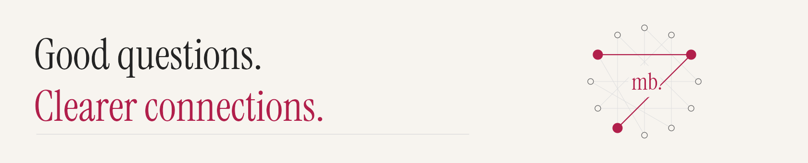

  

# Margarita Bermejo Cano

**People science · Research · R-first data storytelling**

I enjoy following a question through the data—and noticing the details that
change how I read the answer. A different denominator, an assumption worth
checking, a pattern that needs a second look.

**R is my first choice.** I’m learning by building, comparing methods, and finding
clearer ways to share what I discover.

**[Featured study](#featured-study)** ·
**[Worth a Look](#worth-a-look)** ·
**[Find the code](#find-your-way)** ·
**[Visit my career portfolio ↗](https://mberca.github.io/cv-margarita/)**

## Featured study

### Titanic / Patterns, Prediction & Uncertainty

**One dataset. Three ways to ask a question.**

Which patterns appear together? What helps predict survival? How uncertain are
the group estimates? I explore these questions with association rules, a random
forest, and Bayesian analysis in **R and Python**.

The study uses a documented **891-passenger subset of public historical data**,
not a complete passenger manifest. The two editions share a held-out comparison;
the results describe patterns and predictions, not causes.

**[Explore the story ↗](https://mberca.github.io/titanic-patterns/)** ·
[R edition](https://github.com/mberca/titanic-patterns/tree/main/R) ·
[Python edition](https://github.com/mberca/titanic-patterns/tree/main/Python) ·
[Methodology](https://github.com/mberca/titanic-patterns/blob/main/METHODOLOGY.md) ·
[Repository](https://github.com/mberca/titanic-patterns)

  
Take a look inside the study

  

    
  

## Worth a Look

A space for something new, recently revisited, or worth sharing.

### October 2026 · Wonderland, Measured

**Two words, a Python dictionary, and a very curious book.**

I revisited a programming project I first wrote in 2013/14: counting **Alice**
and **Rabbit** in *Alice’s Adventures in Wonderland*. The original question
is still there, now alongside chapter charts, a searchable text, and a local
MapReduce lab.

The interesting part: a counting rule or a chapter’s length can change the
answer. The reading room lets you follow the numbers back to the passages.

**[Visit the reading room ↗](https://mberca.github.io/alice-in-wonderland-analysis/)** ·
[Python code](https://github.com/mberca/alice-in-wonderland-analysis/tree/main/wonderland) ·
[Methodology](https://github.com/mberca/alice-in-wonderland-analysis/blob/main/METHODOLOGY.md) ·
[Repository](https://github.com/mberca/alice-in-wonderland-analysis)

  
Take a look inside the reading room

  

    
  

## Find your way

**Titanic in R:** [Getting-started guide](https://github.com/mberca/titanic-patterns/blob/main/R/README.md) ·
[Read the analysis](https://github.com/mberca/titanic-patterns/blob/main/R/analysis.R).

**Wonderland in Python:** [Getting-started guide](https://github.com/mberca/alice-in-wonderland-analysis#reproduce-everything) ·
[Text-analysis code](https://github.com/mberca/alice-in-wonderland-analysis/blob/main/wonderland/core.py) ·
[Local MapReduce lab](https://github.com/mberca/alice-in-wonderland-analysis/blob/main/wonderland/mapreduce.py).

The public stories are **static browser experiences**; no installation is needed
to explore them. The repositories contain the code and reproduction instructions.

## Career & research

For my background and selected professional work, start with my
**[career portfolio ↗](https://mberca.github.io/cv-margarita/)**.
Its [source repository](https://github.com/mberca/cv-margarita) is separate from
the independent analytical projects above.

## How I work & learn

I want the explanation to be as considered as the analysis: a clear question,
a comparison that makes sense, and room for uncertainty. Checking assumptions
and trying another method are part of the exploration, not just the final checks.

These are **AI-assisted learning and showcase projects**, not claims of business
impact. Titanic uses public historical data; Wonderland explores a documented
edition of a public-domain novel. Associations and predictions are not evidence
of causality, and word counts are not measures of literary importance.
